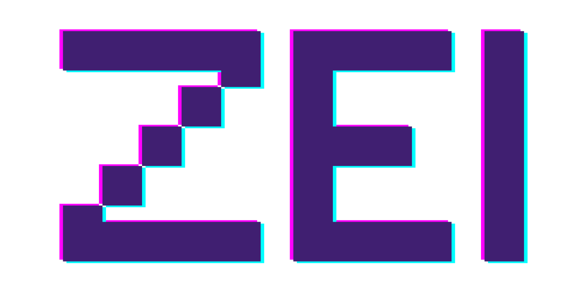

Hello, meet Zei. A high-level, dynamically typed, interpreted programming language developed using Rust.

  

The goal of this project is to create a simple, high-level programming language by by using Rust’s powerful features. As a computer engineering student, I am working on this project on my own. I am using the book \*Crafting Interpreters\* by Robert Nystorm as a reference.

Zei utilizes:

- an error-handling mechanism that collects errors and displays all of them at once,
- efficient memory usage,
- null-safe programming,
- error recovery,
- and more...
