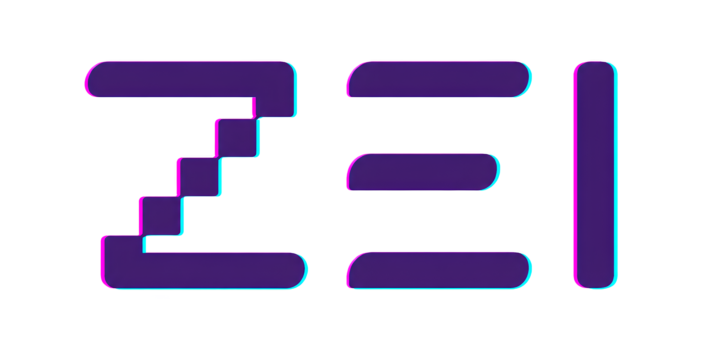

Hello, meet Zei. A high-level, dynamically typed, interpreted programming language developed using Rust.

  

## Documentation

For a more detailed overview of the language and its current implementation, see [docs/language.md](docs/language.md).

Additional notes:

- [docs/usage.md](docs/usage.md) for running the interpreter and REPL.
- [docs/roadmap.md](docs/roadmap.md) for the current limitations and likely next documentation topics.

The goal of this project is to create a simple, high-level programming language by by using Rust’s powerful features. As a computer engineering student, I am working on this project on my own. I am using the book \*Crafting Interpreters\* by Robert Nystorm as a reference.

Zei utilizes:

- an error-handling mechanism that collects errors and displays all of them at once,
- efficient memory usage,
- null-safe programming,
- error recovery,
- first-class function declarations and calls,
- class declarations with instance methods,
- and more...
